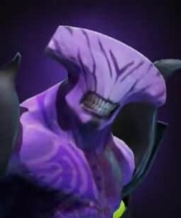

# bio-Faceless Void



一个用于**二维显微切片二分类分割**的 Codex skill。给它单通道原图和人工勾画的目标，它可以训练 2D U-Net，在独立动物上评价分割，再把新切片转换为掩膜、叠加图和每只动物一行的定量表。脚本也可以脱离 Codex 单独运行。

例如，有 VGLUT2 免疫荧光标记的鼠脑切片时，可以比较同一脑区内的 **VGLUT2 阳性面积占比**。分割目标由标记通道和人工标注共同定义。若研究的是 Draxin 蛋白定位，需要相应的实验信号。轴突条数、投射来源和发育机制还需要相应的实验读出。

## 在 Codex 中使用

将整个仓库目录命名为 `bio-faceless-void`，放在个人技能目录 `~/.agents/skills/` 下。Windows 对应 `%USERPROFILE%\.agents\skills\bio-faceless-void\SKILL.md`。打开新会话，在提示中写出技能名，例如：

> 用 $bio-faceless-void 检查我的切片和人工标注。按鼠编号检查训练、验证和测试集，再训练模型并按鼠汇总目标面积占比。

## 安装依赖

推荐用 Python 3.11 的独立环境。在仓库根目录、已激活的环境中执行下列命令。使用 NVIDIA 显卡时先按操作系统和驱动选择合适的 PyTorch 构建，然后安装其余依赖。[PyTorch 官方安装说明](https://pytorch.org/get-started/locally/)

```sh
python -m pip install -r requirements.txt
python -c "import torch; print(torch.__version__, torch.cuda.is_available())"
```

`--device cpu` 可在 CPU 上运行，`--device cuda` 要求 PyTorch 能使用 NVIDIA 显卡，`--device auto` 自动选择。在显存紧张时可先尝试 `--batch 1`，再按结构大小调整 `--tile`。

## 用模拟图跑一遍

下面的命令可逐行执行。示例使用生成的 16 位 TIFF，其中有效亮度范围为 0–4095。每次请指定新的输出目录，以保留上一次结果。示例中的模拟动物数量只用于测试软件。

```sh
python scripts/demo.py demo-data
python scripts/unet.py audit demo-data/manifest.csv
python scripts/unet.py train demo-data/manifest.csv --out runs/demo-train --scale 4095 --tile 32 --epochs 8 --batch 2 --crops 4 --device cpu
python scripts/unet.py evaluate demo-data/manifest.csv --weights runs/demo-train/best.pt --out runs/demo-test --device cpu
python scripts/unet.py predict demo-data/predict.csv --weights runs/demo-train/best.pt --out runs/demo-predict --device cpu
```

## 换成自己的切片

准备一个 UTF-8 CSV，每行对应一个视野或一个裁好的矩形组织区域（ROI）。路径相对于 CSV 所在目录。下面仅展示格式，每只鼠的所有视野和切片都要使用同一个稳定编号并归入同一组。

```csv
animal_id,split,image,mask
M01,train,images/M01_01.tif,masks/M01_01.png
M02,val,images/M02_01.tif,masks/M02_01.png
M03,test,images/M03_01.tif,masks/M03_01.png
```

- **原图**使用单页、单通道灰度 TIFF 或 PNG，保留原始位深。多通道、彩色或 Z-stack 数据请先导出目标通道和所需的二维平面，并记录选择规则。
- **标注**必须与图像逐像素配准、尺寸相同。每个掩膜用 0 表示背景，使用 1、255、65535 中的一种表示目标。真实阴性视野可以全零。训练集和验证集各至少需要一个包含目标的标注。
- **划分**先按动物分配 train、val、test，再裁图。保持两组动物的成像和取样条件可比，检查发育阶段、实验批次及基因型覆盖。审计能发现相同动物编号及跨组完全相同的图像，近似重复的视野和错误编号仍需核对原始记录。
- **输入亮度**用 `--scale` 指定所有图共用的强度上限，超过上限会在输入模型时截断。按原始采集设置选取，例如 8 位可用 255，12 位数据用 4095。训练和预测共用这套转换。不要按 WT/KO 组分别选取比例。
- **量化区域**为提供的整张二维图。使用尺寸或取样规则可比、像素物理大小一致且互不重叠的视野。图中留白也会计入分母。如果需要以不规则组织轮廓为分母，须用独立的组织 ROI 掩膜重新计算组织内的占比。可把导出的预测掩膜带入 Fiji 完成该步。
- **新图预测**只需 `animal_id,image` 两列，无需人工掩膜。使用本项目已训练、目标和成像条件匹配的 `best.pt`。示例权重可通过上面的模拟数据生成。

把示例命令的 CSV 和输出路径改为自己的路径即可。真实数据训练的默认设置为每张图每轮随机抽取 4 个 256 × 256 的图块、每批 2 个、共 20 轮。可按验证集表现调整。图像与标注同步裁剪。仅当镜像不会改变解剖意义时使用 `--flip`。

## 如何读输出

| 文件 | 内容 |
| --- | --- |
| `best.pt`、`settings.json`、`history.csv` | 验证集前景 Dice 最佳轮次的权重，训练设置，以及各轮的损失和验证 Dice |
| `00001_mask.png`、`00001_overlay.png` | 与原图大小相同的二值掩膜和标出预测前景的红色叠加图。通过 `images.csv` 的 `output_id` 对应原图 |
| `images.csv` | 每图总像素、阳性像素、阳性面积占比和阳性像素的原始平均强度 |
| `animals.csv` | 每只动物一行。面积占比为该鼠全部阳性像素数除以该鼠全部输入像素数。阳性平均强度按该鼠全部预测阳性像素加权，无阳性时留空 |

模型使用三次下采样、跳跃连接、单通道输出和二元交叉熵损失。训练时只更新 train 上的参数，val 用于选择轮次。预测在原分辨率上使用重叠图块，平均重叠处的概率后以 0.5 为阈值。图像小于图块时先延拓边缘，再恢复到原图大小。

`evaluate` 读取 test 行并与人工标注比较。表中附有真阳性、假阳性、假阴性，以及只针对前景计算的 Dice 和 IoU。两种掩膜都为空时分数留空，预测为空但人工标注有前景时分数为 0。每只鼠的分数由该鼠合并的像素计数计算。先核看弱信号和阴性视野的叠加图，再做组间比较。分割一致性、阳性面积和荧光强度分别回答不同的问题。

## 验证与上传 GitHub

```sh
python tests/test_workflow.py -v
```

测试会在临时目录生成模拟图，检查真实的训练、评价和预测流程、原图和掩膜的尺寸、定量值以及重复动物和重复图像的拦截。仓库附带 GitHub Actions 配置，推送后会在 CPU 上执行这组测试。

上传时将本目录的**内容**放在仓库根目录，保留隐藏的 `.github` 和 `.gitignore`。仓库只包含代码、头像、说明和测试。请将真实切片、样本清单及训练输出保存在仓库外或忽略目录中。头像使用创建者提供的图片，公开分发时请自行确认其使用权限。

